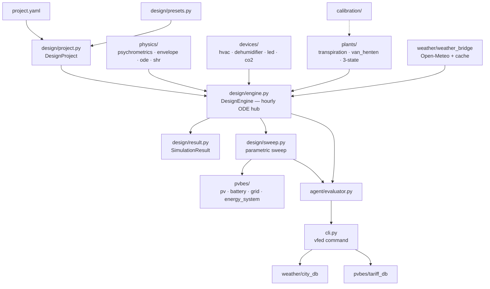

# VFED Repository Architecture Map

> Single source of truth for **what lives where** in this repository and **which module may import which**.
> Referenced by `README.md` / `README_zh.md` (Repository Structure), `AGENTS.md` (Repository Layout), and `REVIEW.md`.
> Update this file whenever the layout changes. Reorganisation history: `docs/planning/`.

## 1. Repository layout

### Tracked — active

| Path | Role |
|------|------|
| `vfed/` | The simulator package — see §2 |
| `tests/` | Pytest suite (866+ tests). CI (`.github/workflows/ci.yml`) runs it on push/PR for Python 3.10–3.12. Do not move. |
| `examples/` | Example project YAMLs (`example_sweep.yaml`, `example_lcoe_full.yaml`) |
| `data/` | `data/weather/` city CSVs (offline quickstart); `data/datasets/` public datasets (git-ignored except `*.md`) |
| `docs/` | `architecture.md` (this file) · `reports/` (technical deliverables) · `references/` (PV/BES validation data — datasheets, measured curves; `battery.py`/`modules.py` load anchors from here at runtime) · `planning/` (dated session plans) |
| `tools/` | Maintenance utilities — `download_weather_db.py` refreshes `data/weather/` |
| `benchmarks/` | BESTEST (ASHRAE 140) harness + growth benchmarks (BJAAF, UC Davis, respiration) |
| `research/` | **Archived paper code** — frozen for reproducibility. Never imported by `vfed/`. |
| Root files | `README.md` · `README_zh.md` · `AGENTS.md` · `REVIEW.md` · `CHANGELOG.md` · `CONTRIBUTING.md` · `LICENSE` · `pyproject.toml` |

### Local-only (git-ignored, machine-specific)

| Path | Role |
|------|------|
| `gadget/` | Creative/game projects. **Never move** — this volume is managed by a bidirectional cloud-sync layer that reverts local moves (see AGENTS.md). |
| `user-gym/` | Local evaluation playground |
| `backups/` | Local sink for material moved out of the repo |
| `weather_cache/` | Runtime weather cache — the default `--cache weather_cache` target. Regeneratable; 7 code sites hardcode this default path. |
| `.scratchpad/`, `.workbuddy/` | Agent working files |
| `vfed-workspace.code-workspace` | VS Code workspace file |

## 2. Code architecture

### Layering — who may import whom

```text
Layer 3 (entry):    cli.py · agent/evaluator.py
Layer 2 (design):   design/ — sweep.py · engine.py · project.py · presets.py · fx.py · result.py
Layer 1 (domain):   physics/ · devices/ · plants/ · weather/ · pvbes/
Standalone:         calibration/ (imports plants only; nothing imports it)
Frozen archive:     research/ (imported by nothing)
```

Rules (enforced by `tests/test_architecture.py`):

1. Layer-1 packages (`physics`, `devices`, `plants`, `weather`, `pvbes`) **never import** `design`, `agent`, `cli`, or `calibration`. Intra-layer edges are allowed: `devices` → `physics` (COP / SMER psychrometrics) and `plants` → `physics` (saturation-deficit transpiration).
2. `design/engine.py` is the hub — it imports `physics` (psychrometrics, envelope, ode, shr), `devices` (hvac, dehumidifier, led, co2), `plants` (transpiration, van_henten, van_henten_3state), and `weather` (`fetch_weather`).
3. `design/sweep.py` additionally imports `pvbes` (pv, battery, grid, energy_system) and `design.engine`.
4. `agent/evaluator.py` imports `design` only. `cli.py` additionally imports `weather.city_db` and `pvbes.tariff_db`.
5. `calibration/` imports `plants` only.
6. Nothing imports from `research/`.

### Dependency graph



### Data flow

`project.yaml` → `DesignProject` (`design/project.py`) → `DesignEngine` hourly loop — 8,760 steps of room heat & moisture ODE + device dispatch (`design/engine.py`) → `SimulationResult` (`design/result.py`) → parametric sweep × PVBES dispatch (`design/sweep.py` × `pvbes/`) → LCOE / NPV / IRR ranking → CLI / agent output.

### Module table

| Package | Contents |
|---------|----------|
| `physics/` | psychrometrics (wet-air thermodynamics), envelope (UA, solar gains), ode (`RoomODESolver`), shr (`DynamicSHR`) |
| `devices/` | hvac (4 COP modes, Carnot default), dehumidifier (auto-size, DOE/E+ SMER curves), led, co2 (M1 balance, default off) |
| `plants/` | transpiration (5 methods), van_henten (1-state growth), van_henten_3state (C_buf + LAI) |
| `weather/` | weather_bridge (Open-Meteo fetch + cache), city_db |
| `pvbes/` | pv (single-diode), battery (datasheet-anchored), grid (TOU tariff), energy_system, modules (module library), tariff_db |
| `design/` | project (config contract), presets, engine (hub), sweep, fx (currency), result |
| `agent/` | evaluator (agent-cli contract) |
| `calibration/` | dataset adapters, identifiability analysis, golden-section fitting |

### Big files (change with care)

| File | ~Lines | Note |
|------|--------|------|
| `design/project.py` | 2,600 | YAML config contract — every config field starts here (+ `presets.py`) |
| `design/engine.py` | 2,200 | Hub; hourly-loop split-out planned (see §3) |
| `cli.py` | 1,500 | `vfed` command |
| `design/sweep.py` | 900 | PVBES sizing sweep |

## 3. Pending reorganisation

- **C5** — `design/engine.py` hourly-loop split, interface-preserving: `DesignEngine` / `run_project` / `full_load_warnings` / `SimulationResult` import paths and signatures stay frozen.
